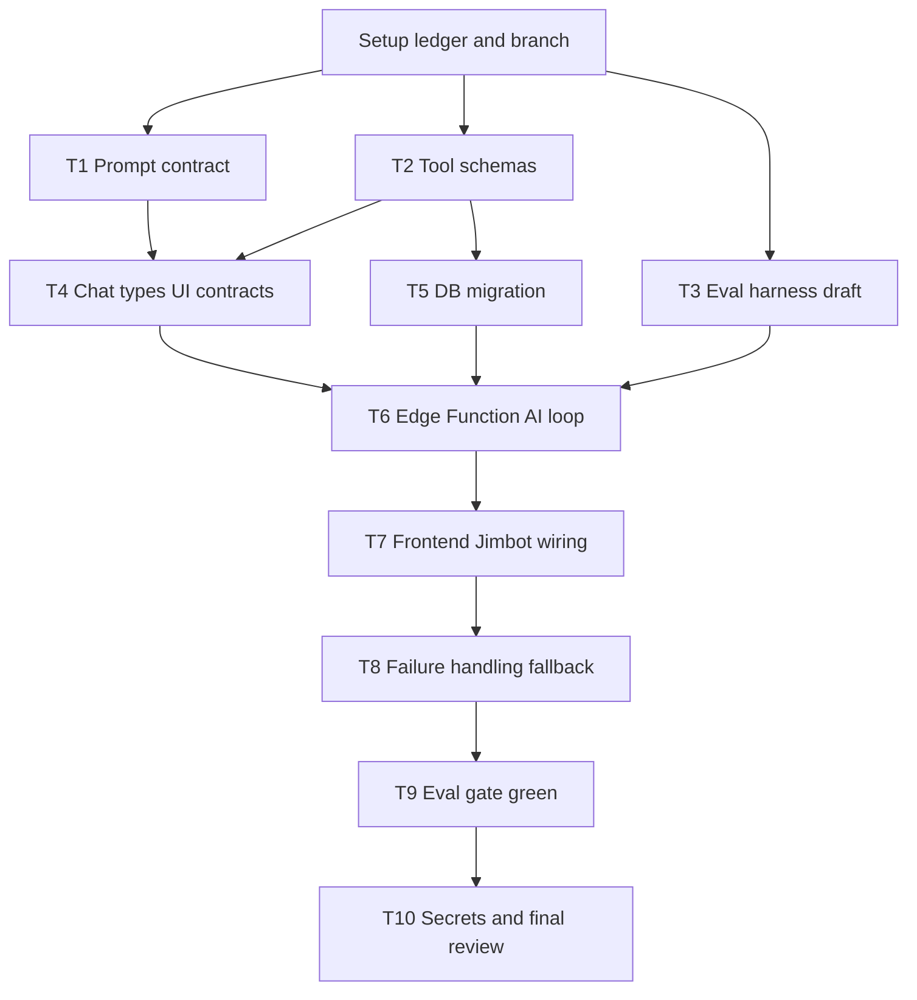

# Jimbot V2 — Subagent-Driven Implementation Plan

Status: executing on `feature/jimbot-v2-ai`.

Approved product scope: itinerary + budget only, Taglish mobile persona, OpenAI via Supabase Edge Function, verified businesses only, explicit save, deterministic fallback.

## Skills pack (installed)

| Skill | Location | Use when |
|---|---|---|
| prompt-engineering | `.cursor/skills/prompt-engineering` + user store | Writing Jimbot system prompt + orchestrator/subagent prompts |
| tool-use-schema-design | `.cursor/skills/tool-use-schema-design` | Designing OpenAI tools |
| tool-failure-handling | `.cursor/skills/tool-failure-handling` | Retries, timeouts, fallbacks |
| agent-evaluation-harness | `.cursor/skills/agent-evaluation-harness` | Golden chats + ship gate |
| ponytail | plugin | Keep implementation minimal |
| supabase / supabase-postgres-best-practices | local | Edge Function + migrations + RLS |
| TDD / verification-before-completion / secrets-leak-check | local | Quality + safety |

## Orchestrator

- Role: Sol (`gpt-5.6-sol-medium`)
- Owns: plan ledger, task order, rulings, dispatch, re-dispatch after review findings
- Does not: write product code itself when a specialist can
- Must follow: `subagent-driven-development`, `ponytail`, approved Jimbot v2 product plan

## Subagent roster and models

| ID | Role | Model | Job |
|---|---|---|---|
| A | Spec & Prompt Engineer | `claude-opus-5-5-medium` | Finalize Jimbot system prompt, few-shots, refusal scripts, structured response contract |
| B | Tool Schema Designer | `gpt-5.6-terra-medium` | Design allowlisted OpenAI tools + JSON schemas + side-effect rules |
| C | Eval Harness Builder | `claude-sonnet-5-5-low` | Golden set (≥20), deterministic scorers, persona checks, CI gate |
| D | Backend Implementer | `gpt-5.3-codex` | Supabase Edge Function, OpenAI Responses API, tool loop, failure handling, secrets |
| E | Data/RLS Implementer | `gpt-5.3-codex` | Migration for structured chat payload + planning context; keep schema.sql synced |
| F | Frontend Implementer | `claude-sonnet-5-5-low` | Chat contract types, mobile cards, map pins, save UX, fallback wiring |
| G | Task Reviewer | `claude-opus-5-5-medium` | After each task: spec compliance + quality + ponytail check |
| H | Final Branch Reviewer | `claude-opus-5-5-medium` | Whole-branch review against product plan + security |
| I | Security/Secrets Checker | `composer-2.5-fast` | No key leakage, no VITE_OPENAI, RLS ownership checks |

Notes:
- Prefer fresh subagent per task (no inherited chat history).
- Orchestrator provides a self-contained task brief every time.
- Backend and Data can run sequentially (schema before Edge Function save path). Spec/Prompt + Tool Schema + Eval can start first and partly in parallel after contracts stabilize.

## Task graph (SDD)

### T1 — Prompt contract (Agent A)
Inputs: approved persona + scope.
Outputs:
- `jimbot.system.md` content for Edge Function
- structured response schema draft
- refusal examples
Acceptance: no bullets/em dashes in sample replies; itinerary/budget only; ≤2 short sentences in chat text; ≤1 emoji.

### T2 — Tool schemas (Agent B)
Tools (allowlist):
- `search_verified_businesses`
- `get_business_details`
- `get_user_preferences` (consent-gated)
- `get_saved_itineraries`
- `build_itinerary_draft` (read-only draft)
- `show_map_points`
- `save_itinerary` (explicit user confirm only)
Acceptance: every tool has purpose, params, side effects, failure modes; save cannot be auto-invoked without UI confirm flag.

### T3 — Eval harness (Agent C)
Outputs under `tests/jimbot-ai/`:
- golden chats (≥20)
- deterministic checks: schema valid, verified IDs only, persona regex, scope refusal
- optional rubric for free-form tone later
Acceptance: harness fails on invented business IDs, medical answers, em dashes, bullet lists in chat text.

### T4 — Chat types + UI contracts (Agent F light / shared)
Extend `src/data/chat.ts` and add renderer stubs under `src/components/jimbot/`.
Acceptance: TypeScript compiles; Msg supports itineraryDraft, budget, map, actions, warnings, refusal.

### T5 — DB migration (Agent E)
Add JSONB fields for structured bot payload + conversation planning context; keep RLS ownership; sync `schema.sql`.
Acceptance: migration applies on local Supabase; RLS still user-scoped.

### T6 — Edge Function (Agent D)
`supabase/functions/jimbot/` using Responses API + tools + structured output + rate limits + OPENAI_API_KEY secret.
Acceptance: local invoke returns validated structure; never returns unverified IDs; falls back cleanly on OpenAI failure.

### T7 — Frontend wiring (Agent F)
Replace hardcoded primary path with Edge Function call; keep keyword bot as fallback; render cards/map/save.
Acceptance: create plan → revise “mas mura” → map pins → explicit save works on mobile layout.

### T8 — Failure handling (Agent D/F)
Timeouts, retries, partial tool failure, offline keyword fallback, user-visible short Taglish errors.
Acceptance: tool failure does not crash chat; unrelated requests still refused.

### T9 — Eval gate green (Agent C + orchestrator)
Run deterministic harness + existing `pnpm test:jimbot` + `pnpm test:auth` + `pnpm build`.
Acceptance: all green.

### T10 — Secrets + final review (Agents I + H)
No secrets in client; no VITE_OPENAI; PR-ready summary.
Acceptance: secrets-leak-check clean; final review approved or findings ruled.

## Per-task SDD loop

1. Orchestrator writes task brief (goal, files, constraints, acceptance, skills to load).
2. Dispatch implementer with fresh context.
3. Implementer: TDD where possible → implement → self-review → report.
4. Dispatch task reviewer with diff + acceptance criteria.
5. Fix rounds ≤5; ledger rulings for conflicts.
6. Mark task complete; next task.

## Stop conditions (ask user)

- Need to put/use real OPENAI_API_KEY in secrets
- Push / PR / merge
- Destructive DB reset against non-local data
- Plan becomes guesswork

## Non-goals in this build

- Business-owner Jimbot (`src/biz/pages/JimbotChat.tsx`)
- Live weather/traffic/routing times
- Standalone place search outside itinerary/budget
- Installing Braintrust/Langfuse MCP (later)
